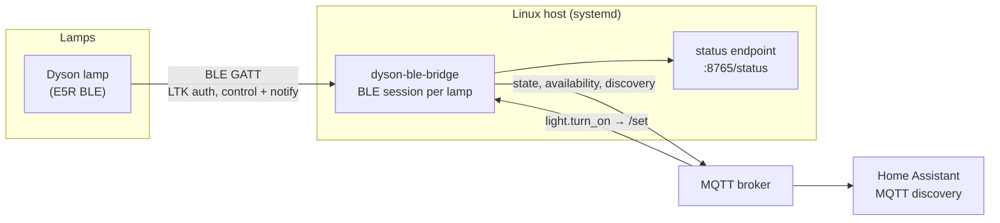

# dyson-ble-bridge

Expose **Dyson Solarcycle Morph (E5R/E5V) BLE-only lamps to Home Assistant over MQTT**, for hosts
whose Bluetooth adapter Home Assistant cannot use directly — a Linux box, a container, or a Home
Assistant OS install with no usable BLE path of its own.

The lamps advertise and connect over Bluetooth Low Energy only and authenticate with a per-device
Long Term Key. This bridge owns those BLE links, speaks the lamp protocol (reconstructed here, see
[`docs/reverse-engineering.md`](docs/reverse-engineering.md)), and republishes each lamp as
standard Home Assistant MQTT discovery: a `light` entity with on/off, brightness and colour
temperature, plus the lamp's occupancy sensor as a `binary_sensor`.

* Status: running 4 lamps in production on a Linux host (`systemd`, watchdog, single-instance lock)
* Tests: `76 passed`, `ruff` clean, `mypy --strict` clean
* Version: `v0.1.4`
* Licence: MIT

---

## Why a bridge instead of the obvious alternatives

| Option | Why not |
| --- | --- |
| ESPHome Bluetooth proxy + a Home Assistant BLE integration | A proxy gives Home Assistant a *radio*, and the lamp's GATT server tolerates exactly one active connection. Keeping a proxy link open next to anything else (the phone app, a previous integration) makes the lamps flap. The bridge keeps the link on the host that is permanently near the lamp and publishes state over MQTT, so Home Assistant never touches the radio. |
| Running the integration on the same host as Home Assistant | Only works when that host has a usable adapter. This bridge is the way to give Home Assistant lamps that are *not* in range of it — or to keep BLE traffic out of the Home Assistant process entirely. |
| Dyson's cloud | Not needed after setup: the only cloud call is a one-off fetch of each lamp's LTK. Control is local BLE, no polling, no rate limits, works when the internet is down. |

## Architecture



One asyncio process, one MQTT client, one BLE session per lamp:

* **Supervisor per lamp** (`bridge.py`) — owns the lamp's lifecycle: connect (staggered, one at a
  time because a single adapter cannot run two connect procedures concurrently), monitor, refresh,
  backoff-and-retry, availability, MQTT topics, counters.
* **Link layer** (`link.py`) — the authenticated GATT session: handshake, notification
  subscriptions, reads, paced writes. Runs against an injectable transport, so the whole session is
  tested against a fake lamp with no hardware.
* **Protocol layer** (`protocol.py`) — pure functions: framing, HKDF key derivation, AES-CBC +
  HMAC envelopes, payload encoding. No I/O, unit-tested against vectors captured from real lamps.
* **Home Assistant layer** (`ha.py`) — discovery payloads and command parsing, i.e. everything whose
  correctness is defined by Home Assistant's MQTT schema rather than by the lamp.

## What was verified, and how

Everything below was proven against real lamps (product code `PF000552`, firmware `5.17`), not
inferred from other implementations. The full protocol write-up is in
[`docs/reverse-engineering.md`](docs/reverse-engineering.md).

| Fact | Evidence |
| --- | --- |
| Key derivation | `HKDF-SHA256(salt=b"", ikm=LTK, info="USER_AUTH_AES\0\0\0", len=16)`; a unit-test vector is a key observed in a live session |
| Envelope | `IV(16) ‖ AES-128-CBC ‖ HMAC-SHA256(key, ciphertext)` — encrypt-then-MAC, **not** AES-GCM |
| Handshake | `0x06` = account GUID ‖ `00 00` ‖ envelope(nonce); `0x07` = `00 00` ‖ IV ‖ CT(32) ‖ MAC(32) with CT = nonce echo ‖ challenge; a wrong LTK fails the echo check |
| Framing | 20-byte ATT fragments, first header `0x80 \| (total-1)`, later `index & 0x7F`, writes paced ~60 ms |
| Control | power `2dd11005` (1 byte), brightness `2dd11009` (uint16 LE, 100–1000 lm), colour `2dd11001` (uint16 LE, 2700–6500 K) — **write-without-response** on this model |
| Write properties | the light characteristics advertise only `write-without-response`; an ATT Write Request is refused with `0x03 Write Not Permitted`, which is why the upstream integration silently dropped every command (fixed in [cmgrayb/hass-dyson#509](https://github.com/cmgrayb/hass-dyson/pull/509)) |
| Daylight mode | the lamp ignores manual brightness/colour writes while its daylight algorithm runs, so the bridge writes `13 20 01 00 00` to `2dd10021` first |
| Write coalescing | a colour write sharing a burst with a brightness write is dropped (brightness applied, colour left at the old value) — the two value writes are spaced 200 ms apart |
| State read-back | after every command the bridge re-reads the lamp; the published state is the device's own value (e.g. write 400 lm → read 400 lm) |
| Home Assistant contract | HA's `schema: json` light keeps the `color_temp` key and only switches its unit with `color_temp_kelvin: true`; `brightness_scale: 1000` carries the lumen range; `color_mode` must be present or HA ignores colour temperature |
| Availability | per-lamp *and* bridge-wide topics, retained, with an MQTT last-will so a dead bridge marks the entities unavailable instead of leaving stale state |
| Motion | event-driven notifications only, deliberately **not** retained, so a restart cannot resurrect stale motion |

## Quick start

Prerequisites: Linux with a working Bluetooth adapter (BlueZ), Python 3.12+, and an MQTT broker.

```bash
git clone https://github.com/andreanjos/dyson-ble-bridge
cd dyson-ble-bridge
python3 -m venv .venv
.venv/bin/pip install .
```

### 1. Get each lamp's serial, BLE MAC and LTK

The **serial** and the **LTK** come from Dyson's cloud; the **MAC** is what the lamp advertises
(grab it from `bluetoothctl scan on` — it is printed on the base sticker too).

The LTK is a per-device key served by `GET /v1/lec/{serial}/ltk` with your Dyson account's bearer
token. The lamp has to be registered in the MyDyson app first — an unregistered lamp has no key
anywhere. See [`docs/reverse-engineering.md`](docs/reverse-engineering.md#long-term-key-ltk) for
the token flow (email OTP, or reusing the token Home Assistant already stored).

### 2. Write the configuration (mode 0600 — it holds keys and the MQTT password)

```json
{
  "account_uuid": "00000000-0000-0000-0000-000000000000",
  "mqtt": {"host": "10.0.0.10", "port": 1883, "username": "homeassistant", "password": "…"},
  "status_port": 8765,
  "lamps": [
    {"serial": "E5R-US-PKA0710A", "mac": "C7:4D:76:76:15:EB", "name": "Downstairs",
     "ltk": "00112233445566778899aabbccddeeff"}
  ]
}
```

* `account_uuid` — the Dyson account GUID, used in the handshake.
* `mqtt` — broker address and credentials (`port` defaults to 1883).
* `status_port` — HTTP status endpoint, defaults to 8765.
* `lamps[]` — one entry per lamp: `serial`, BLE `mac`, a `name` used in Home Assistant, 32-hex-char
  `ltk`. The bridge validates everything and refuses to start on a bad file (`--check` does that
  without connecting).

### 3. Validate and run

```bash
.venv/bin/dyson-ble-bridge --config ~/dyson-bridge/config.json --check
.venv/bin/dyson-ble-bridge --config ~/dyson-bridge/config.json --log-level INFO
```

Lamps connect staggered a few seconds apart and appear in Home Assistant within a minute.

## Deployment (systemd)

```bash
sudo cp deploy/dyson-ble-bridge.service /etc/systemd/system/
sudo systemctl enable --now dyson-ble-bridge
```

The shipped unit is a production configuration, not a minimal one:

| Setting | Purpose |
| --- | --- |
| `Type=notify` + `WatchdogSec=60` | the bridge pings the watchdog from its event loop; a hung loop is restarted instead of pretending to work |
| `Restart=always`, `RestartSec=10` | survives adapter hiccups and lamp outages |
| `After=bluetooth.target network-online.target` | BlueZ and the network are up first; the per-lamp backoff covers the rest |
| `RuntimeDirectory=dyson-ble-bridge` | fresh lock directory on every boot, so no stale lock blocks startup |
| `User=root` | BlueZ's D-Bus policy grants access to root or the `bluetooth` group |
| `ProtectSystem=strict`, `ProtectHome=read-only`, `PrivateTmp`, `SystemCallFilter=@system-service`, `RestrictAddressFamilies=AF_UNIX AF_INET AF_INET6 AF_BLUETOOTH` | the VPN-friendly minimum the adapter needs and nothing else |

Verified boot behaviour: the unit is `enabled`, `systemd-analyze verify` passes, the adapter is
unblocked by `rfkill` and auto-powered by BlueZ, and the executable works under a clean environment
(`env -i`). After a reboot the entities are unavailable for ~10–60 s while the lamps reconnect, then
live again.

Environment overrides: `DYSON_BRIDGE_CONFIG` (default config path) and `DYSON_BRIDGE_LOCK` (lock
file, default `/run/dyson-ble-bridge.lock`).

## Home Assistant

The bridge publishes MQTT discovery under `homeassistant/…` for every lamp:

* `light.<name>` — on/off, brightness, colour temperature 2700–6500 K
* `binary_sensor.<name>_motion` — the lamp's own occupancy sensor (`device_class: motion`)

Device entries carry `manufacturer: Dyson`, `model: Solarcycle Morph (E5R)` and
`sw_version: PF000552 / fw 5.17`, so they show up properly in the device registry.

### Wire contract with Home Assistant

Discovery is `schema: json` with `brightness: true`, `brightness_scale: 1000`,
`color_temp_kelvin: true`, `supported_color_modes: ["color_temp"]`. Three details of that schema
matter, because getting any of them wrong fails quietly:

* Home Assistant *keeps the `color_temp` key name* and switches only its unit — with
  `color_temp_kelvin: true` it reads and writes kelvin under `color_temp`, never
  `color_temp_kelvin`. State and commands both use `color_temp`.
* `brightness_scale: 1000` makes Home Assistant scale its 0–255 UI range to the lumen range the
  lamp uses, so the bridge passes `brightness` through as lumens.
* Without `color_mode` in the state payload Home Assistant never exposes colour temperature, and a
  `color_temp` value arriving while the mode says `brightness` is dropped.

The bridge publishes `{"state": "OFF"}` (attributes omitted) when a lamp is off, and only after the
lamp itself has reported — an invented "OFF" would show up for a lamp that is on.

Availability is published per lamp *and* bridge-wide, so a dead bridge or an out-of-range lamp marks
its entities unavailable instead of leaving a plausible-looking stale state.

### For agents writing automations

[`docs/home-assistant-agent-brief.md`](docs/home-assistant-agent-brief.md) is a short, pasteable
brief with the facts an automation author (or an agent) cannot discover from the entities: the
brightness scale, colour-temperature units, the single-call rule, the 1–2 s settle time, the
daylight-mode side effect of manual writes, non-retained motion, and what `unavailable` means here.

## Operations

```bash
curl -s http://<host>:8765/status
```

```json
{"mqtt_connected": true, "uptime_s": 554.8,
 "lamps": {"E5R-US-PKA0626A": {"name": "Dyson Study", "connected": true, "connects": 1,
                               "failures": 0, "last_error": null,
                               "state": {"on": true, "lumens": 102, "kelvin": 2700}}}}
```

That endpoint is how you tell "the lamp is off" from "the radio is wedged": `connected: false` with
a rising `failures` count means the adapter or the range, not Home Assistant.

| Task | How |
| --- | --- |
| Add a lamp | register it in the MyDyson app, fetch its LTK, append it to `config.json`, restart the unit |
| Remove a lamp | drop it from `config.json` and clear its retained discovery payloads, otherwise Home Assistant keeps the entities as unavailable: `mosquitto_pub -h <broker> -r -n -t homeassistant/light/dyson_ble_<serial>/config` and the same for `homeassistant/binary_sensor/dyson_ble_<serial>_motion/config` |
| Diagnose a lamp | `/status` for link state, then `journalctl -u dyson-ble-bridge -f` with `--log-level INFO` |
| Raise the detail | run the CLI with `--log-level DEBUG` |
| Move the host | the MACs are stable; nothing else is location-bound |

The status endpoint listens on **all interfaces** (`0.0.0.0:8765`) and requires no authentication —
firewall it if the host is not on a trusted network.

Shutdown semantics: on `SIGTERM` the bridge cancels each supervisor (closing its BLE link) and stops
the MQTT client without a `DISCONNECT` packet, so the broker publishes the retained last-will
`offline` on the bridge availability topic and Home Assistant marks every bridge entity unavailable
immediately. Discovery is not pruned on exit; only a fresh `announce()` republishes it.

Common failure modes and what they look like:

| Symptom | Cause | What to do |
| --- | --- | --- |
| `connected: false`, `last_error: link lost` repeatedly | lamp out of range or powered off at the wall | improve placement; the bridge retries with jittered backoff by itself |
| `TimeoutError: … is not advertising` | lamp asleep, or a second client holds it (phone app, another proxy) | close the other client; unplug/replug the lamp |
| Commands accepted, lamp never changes | another process holds the BLE link, or the lamp is in its own daylight automation | keep one client per lamp; the bridge disables daylight mode before manual writes |
| Entities `unavailable` in Home Assistant, bridge healthy | the lamp's link dropped | nothing: availability recovers on the next successful connect |
| Motion sensor stuck at `unknown` | no movement reported since the bridge started (motion is not retained) | expected; it changes on the next detection |
| Two bridges fighting over the same lamp | a second copy of the service or a leftover debug run | the single-instance lock prevents it; check for stray processes |

## Development

```bash
.venv/bin/python -m pytest        # 76 tests, no hardware needed
.venv/bin/ruff check . && .venv/bin/ruff format --check .
.venv/bin/mypy                    # strict
```

Layout (≈2200 lines including tests):

| File | Role |
| --- | --- |
| `protocol.py` | framing, HKDF, envelopes, handshake payloads, control payloads — pure, vector-tested |
| `link.py` | authenticated GATT session: connect, subscribe, read, paced writes, state reconciliation |
| `bridge.py` | supervisors, MQTT, discovery/availability, status endpoint, watchdog, single-instance lock |
| `ha.py` | discovery payloads and command parsing (the Home Assistant contract) |
| `config.py` | dataclasses and fail-fast validation, including UUID/MAC/hex checks |
| `tests/conftest.py` | `FakeLamp`: speaks the real framing, crypto and handshake, applies writes, coalesces like the hardware |

The fake lamp is what makes the interesting behaviour testable: the handshake (including the
wrong-LTK path), write pacing, daylight-mode ordering, coalescing, link-loss signalling, reconnect
backoff and command handling are all covered without touching a radio.

## Related work

* [cmgrayb/hass-dyson#509](https://github.com/cmgrayb/hass-dyson/pull/509) — the fix for the
  write-property problem this work uncovered, contributed back to the integration: BLE light
  commands are dropped when a lamp only accepts Write Commands. Once that lands, the locally patched
  copy of `hass_dyson` some hosts carry is unnecessary.
* [cmgrayb/hass-dyson discussion #334](https://github.com/cmgrayb/hass-dyson/discussions/334) —
  **S-Termi**'s original reverse engineering of the E5R BLE protocol, which this work confirms and
  extends (framing, envelope, handshake, and the three hardware gotchas above).

## Limitations

* Solarcycle Morph (E5R/E5V) only. The protocol layer is model-agnostic, but every payload here was
  verified on this family; other Dyson BLE devices need their own read-back checks.
* One adapter holds the links; on a single-controller host expect four lamps to be comfortable and
  more to need care (staggered connects, occasional adapter resets).
* The lamp's own Solarcycle daylight automation is switched off by the first manual write — that is
  what makes manual control work at all.
* No RGB, no effects, no fan/oscillation: this model is a light.
* Motion is reported as the lamp sees it (its own PIR), event-driven and never retained.
* Removing a lamp does not prune its retained discovery payload, so Home Assistant keeps the entity
  as unavailable until the payload is cleared (see [Operations](#operations)).

## License

MIT — see [LICENSE](LICENSE).
