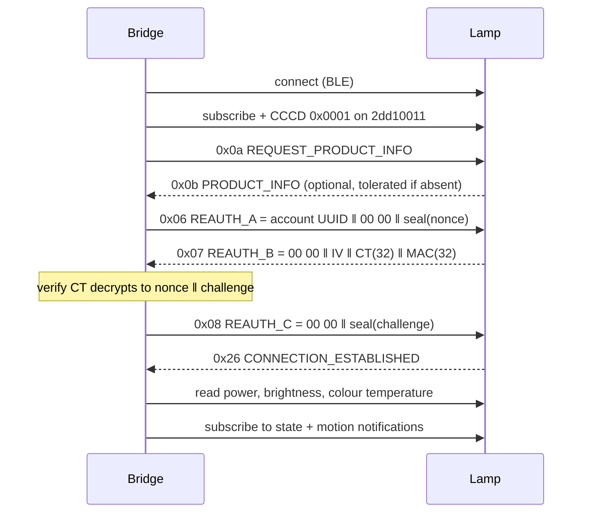

# How the E5R BLE protocol was reconstructed

This is the working record of how the Dyson Solarcycle Morph (E5R/E5V) Bluetooth control protocol
was derived, what was verified on hardware, and where the remaining unknowns are. It is the
evidence behind the summary table in the [README](../README.md#what-was-verified-and-how).

## Method

Four independent sources, cross-checked against each other:

1. **Prior art** — S-Termi's reverse engineering in
   [cmgrayb/hass-dyson discussion #334](https://github.com/cmgrayb/hass-dyson/discussions/334)
   established the framing shape, the envelope and the handshake exchange.
2. **Static analysis of the MyDyson Android app** — characteristic UUIDs, the daylight-mode packet
   and the shape of the control payloads.
3. **Live GATT inspection** — service/characteristic dump of a real lamp (descriptors, properties,
   CCCD state) plus raw reads of every state characteristic.
4. **Write probes with read-back** — every value write was confirmed by re-reading the lamp, not by
   trusting the app's UI: a 400 lm write that reads back 400 lm proves the encoding, the write type
   and the payload length at once.

The implementation then became the fifth source: the same payloads are exercised by unit tests
against a fake lamp that speaks the real framing and crypto, and by a production bridge running four
lamps.

## GATT surface

Service base suffix: `-1c37-452d-8979-d1b4a787d0a4`. The lamp advertises `2dd10010…` (and, once
connected, exposes `2dd10020…`, `2dd1fff0…` plus the standard `1800`/`1801` services).

| Characteristic | Read | Write | Payload |
| --- | --- | --- | --- |
| `2dd10011…` | — | notify + write | authenticated, fragmented request/notify channel |
| `2dd10021…` | — | write | Dyson write-attribute channel (daylight mode) |
| `2dd11000…` | — | write | brightness as one-byte percent (older, non-daylight lamps) |
| `2dd11001…` | read | write | colour temperature, `uint16` little-endian kelvin, 2700–6500 |
| `2dd11005…` | read | write | power, one byte: `00` off / `01` on |
| `2dd11008…` | — | notify | motion: any non-zero byte means movement |
| `2dd11009…` | read | write | brightness, `uint16` little-endian lumens, 100–1000 |

Advertised properties matter: on this family `11001` and `11009` advertise
`read, write-without-response` only. An ATT Write **Request** against them is answered with
`0x03 Write Not Permitted` while the app-visible state still looks fine — the single most expensive
mistake in this protocol (see [Write properties](#1-write-properties-not-the-apps-write-type)).

## Framing

Logical messages are `[type byte][payload]`, split into 20-byte ATT fragments:

| Fragment | Header | Meaning |
| --- | --- | --- |
| first | `0x80 \| (total-1)` | total fragment count in the low 7 bits |
| later | `index & 0x7F` | zero-based fragment index |

Writes are spaced ~60 ms apart: back-to-back fragments are dropped by the lamp. Reassembly ignores
unknown types instead of failing, because lamps emit more message types than the protocol names.

## Session and handshake



* The nonce is **ours**: 16 random bytes per connect attempt.
* Crypto: key = `HKDF-SHA256(salt=b"", ikm=LTK, info=b"USER_AUTH_AES\x00\x00\x00", len=16)`;
  envelope = `IV(16) ‖ AES-128-CBC(plaintext) ‖ HMAC-SHA256(key, ciphertext)` — encrypt-then-MAC.
* A wrong LTK fails at the nonce echo (the lamp's `0x07` cannot be decrypted or the echo does not
  match), which is the check the unit tests pin down.
* Timeouts: 30 s for the handshake, 8 s for the optional product info, 10 s per read.

## Long Term Key (LTK)

The lamp authenticates with a per-device 16-byte key. It is **not** derived from the serial: it is
provisioned by Dyson's cloud when the lamp is registered in the MyDyson app, and served by

```
GET https://appapi.cp.dyson.com/v1/lec/{serial}/ltk      (Bearer account token)
```

Two ways to get a token:

* **Reuse Home Assistant's** — the `dyson_local` config entry stores `{account, token}` from the
  cloud login; a fresh token is enough, no interaction needed.
* **Email OTP login** — create a challenge, read the code from the mailbox, exchange it for the
  token, then list devices and fetch each LEC device's LTK.

An unregistered lamp has no LTK anywhere: registering it in the app is a prerequisite, and this is
why a brand-new lamp appears in a BLE scan but cannot be controlled.

## Control

Every control write follows the same shape:

1. read the characteristic's advertised properties (see below) and pick the ATT write type
2. if the value is brightness or colour temperature, first write `13 20 01 00 00` to `2dd10021…`
   to leave the lamp's daylight automation
3. write the value, space value writes, then sleep ~600 ms and re-read the lamp

The state the bridge publishes is always the lamp's own read-back, never the value it hoped to set.

### 1. Write properties, not the app's write type

The app uses acknowledged ATT Write Requests. This family advertises only
`write-without-response` on `11001`/`11009`, so a Write Request returns `0x03 Write Not Permitted`
and the lamp never changes. Consequence in the wild: the upstream integration's entities look like
they work (the state is updated optimistically) while the physical lamp ignores everything. The fix
is in [cmgrayb/hass-dyson#509](https://github.com/cmgrayb/hass-dyson/pull/509): query the
characteristic's properties and follow them.

### 2. Daylight mode silently swallows manual writes

While the lamp's own Solarcycle daylight algorithm runs, brightness and colour writes are ignored.
Writing `13 20 01 00 00` to `2dd10021…` (`…01` re-enables it) switches the lamp to manual mode; the
mode change needs ~250 ms before the value write lands. Side effect users should expect: the first
manual write permanently takes the lamp off its own daylight schedule.

### 3. Writes inside one burst are coalesced

A colour-temperature write sent immediately after a brightness write is dropped — the brightness
applies, the colour stays at its previous value. Reproduced repeatedly on hardware: `brightness 400
lm + 4200 K` at once gives 400 lm at the *old* colour temperature, while the same pair spaced 200 ms
apart applies both. The bridge therefore spaces the two value writes and its fake lamp coalesces the
same way, so the regression is tested.

## State and notifications

* Initial state comes from reads of `11005` (power), `11009` (lumens) and `11001` (kelvin); unreadable
  characteristics keep their previous value instead of being zeroed.
* Live changes arrive as notifications on the same characteristics, plus `11008` for motion.
* **CCCD quirk**: some stacks accept `start_notify` but leave the Client Characteristic
  Configuration Descriptor at `0000`, so nothing is delivered. The bridge writes `0x0001` to the CCCD
  itself when the stack allows it, and treats a failed subscription as non-fatal (state is then read
  on the periodic refresh instead).
* A dropped link is reported by BlueZ more than once (the disconnect property and the notification
  errors that follow); the bridge signals it exactly once per connect attempt.

## Message catalogue

| Type | Direction | Meaning |
| --- | --- | --- |
| `0x06` | bridge → lamp | `REAUTH_A`: account GUID, reserved zeros, envelope with our nonce |
| `0x07` | lamp → bridge | `REAUTH_B`: reserved zeros, IV, ciphertext(32), HMAC(32) holding nonce ‖ challenge |
| `0x08` | bridge → lamp | `REAUTH_C`: reserved zeros, envelope with the challenge |
| `0x0a` | bridge → lamp | `REQUEST_PRODUCT_INFO` |
| `0x0b` | lamp → bridge | `PRODUCT_INFO` (optional; the session continues without it) |
| `0x26` | lamp → bridge | `CONNECTION_ESTABLISHED` |

## What is not known

* The **contents** of `PRODUCT_INFO` beyond its usefulness as a liveness check — serial and firmware
  are read from the cloud, not from it.
* Whether the remaining advertised service (`2dd1fff0…`) carries anything useful; it is untouched.
* Motion semantics beyond "non-zero means movement": the lamp's own PIR timing and whether it also
  reports light level are unverified.
* Whether other Dyson BLE families share the same service layout (the payload shapes here are
  family-specific and every one was verified by read-back).

## Reproducing the work

The probe tooling used here lives outside this repository (a private research directory) and was
built around three ideas worth reusing:

* **Inventory** — scan for the Dyson service UUID, record name/MAC/RSSI, and compare against the
  configured set: this is how an unregistered fourth lamp was found.
* **GATT dump** — print every characteristic's properties and every CCCD value, which is what
  exposed the write-property mismatch.
* **Controlled probe with read-back** — connect, read state, write one value, sleep, read again: no
  conclusion in this document rests on a write without a matching read-back.

The bridge itself is the long-running version of that probe, and `GET /status` exposes exactly the
values these experiments relied on: per-lamp link state, counters, last error and the lamp's own
reported state.
